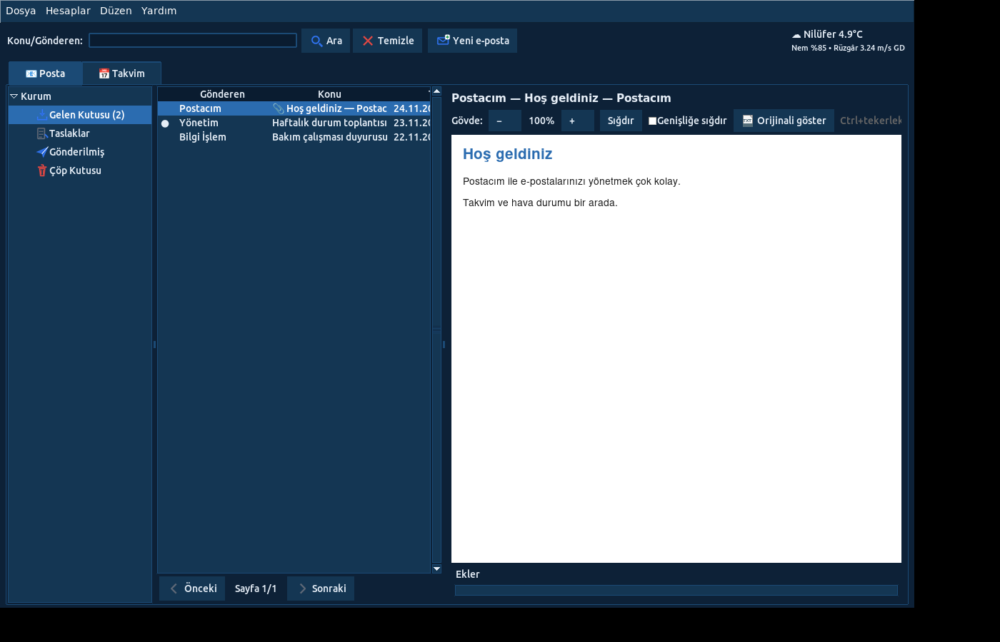
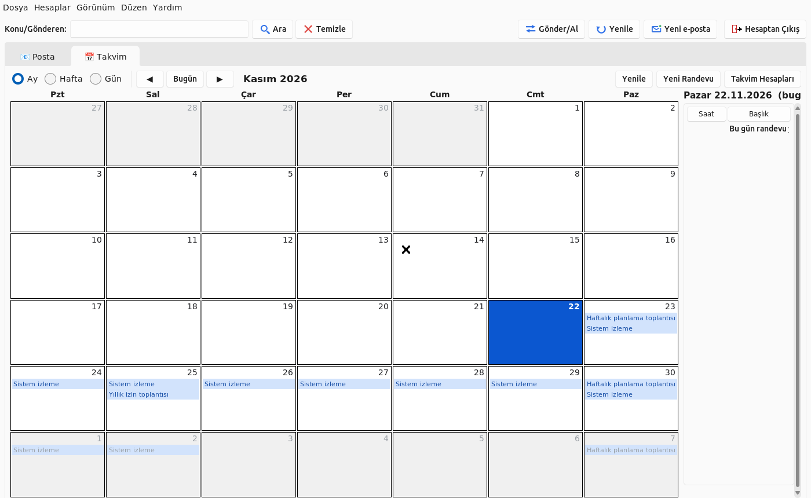

# Postacım

**E-posta ve takvim istemcisi** — Exchange (EWS), IMAP/SMTP ve CalDAV
destekli, Tkinter arayüzlü, hafif ve açık kaynak.

[](https://github.com/cyeniyigit/postacim/actions/workflows/testler.yml)
[](LICENSE)
[](https://www.python.org/)

```
Posta (EWS / IMAP)  +  Takvim (EWS / CalDAV)  —  tek pencerede
```

## Ekran görüntüleri


**Posta** — hesap ağacı, mesaj listesi ve HTML okuyucu:



**Takvim** — Ay görünümü; tekrarlayan olaylar (haftalık/günlük) otomatik
genişletilerek her tekrarı ayrı ayrı gösterilir:



> Ekran görüntüleri **sentetik** verilerle alınmıştır; gerçek mesaj,
> hesap veya takvim bilgisi içermez.

## Neden böyle bir istemci?

Birçok kurumun Exchange sunucusunda **IMAP (143/993) ve SMTP
(25/465/587) portları dışarıdan kapalıdır**. Thunderbird, Evolution, Outlook
gibi istemciler "bağlanamıyor" der — sorun sizde değil, ağ politikasında.

Ama **EWS (Exchange Web Services) 443 üzerinden genelde açıktır**:

| Uç nokta | Durum |
|---|---|
| `https://<sunucu>/EWS/Exchange.asmx` | ✅ açık (NTLM / Basic) |
| `https://<sunucu>/api/v2.0/` | ✅ açık (REST, yedek yol) |
| `https://<sunucu>/autodiscover/autodiscover.xml` | ✅ açık |
| `https://<sunucu>/owa/` | ⚠️ çoğu kurumda yalnız tarayıcı (form girişi engelli) |

Postacım doğrudan EWS'e konuşur → firewall'dan geçer, tarayıcı eklentisi
gerekmez. IMAP/SMTP açık olan sunucular için de tam bir istemci olarak
çalışır (Gmail, Outlook.com, Yahoo, kurumsal IMAP…).

## Kurulum

### En hızlı yol (GitHub'dan)

```bash
git clone https://github.com/cyeniyigit/postacim.git
cd postacim
./kur.sh
```

`kur.sh` geri kalan her şeyi yapar:

- Python 3.10+ kontrolü (yoksa uyarı verir)
- **Tk (tkinter)** kontrolü — eksikse kurulumu durdurup `python3-tk` yolunu gösterir
- **Sanal ortamı** `~/.local/share/postacim/venv` altında oluşturur
- Bağımlılıkları kurar (`requests`, `requests-ntlm`, `sv-ttk`, `Pillow`,
  `tkinterweb`)
- Uygulamayı kurar ve `~/.local/bin/postacim` başlatıcısını oluşturur
- Uygulama menüsüne "Postacım" girdisi ekler (`.desktop` dosyası)
- Kurulumu doğrular (arayüz gerçekten içe aktarılabiliyor mu)

Sonra terminalden `postacim` yazıp çalıştırabilir ya da menüden açabilirsiniz.

> **Kurulumdan sonra Postacım klasörünü silebilirsiniz.** Kurulum, uygulamayı
> sanal ortama kopyalar; menüdeki girdi kaynak klasöre bağlı değildir.

> **Sanal ortam (venv) depoya dâhil edilmez** — projeye gömülmez, çünkü
> her makinede farklı Python/derleyici vardır. `kur.sh` onu sizin için
> oluşturur. Kaldırmak için: `./kur.sh --kaldir`

### Kaldırma

```bash
postacim-kaldir            # uygulamayı kaldırır (ayarları sorar)
postacim-kaldir --tumu     # hesaplar/ayarlar dahil her şeyi siler
postacim-kaldir --ayarlar  # yalnız hesapları ve ayarları siler
```

Kaldırıcı, kurulumdan sonra `~/.local/bin/postacim-kaldir` olarak durur ve
**kaynak klasörü silinmiş olsa bile** çalışır. Sildikleri:

| Ne | Nerede |
|---|---|
| Başlatıcı | `~/.local/bin/postacim` |
| Menü girdisi | `~/.local/share/applications/postacim.desktop` |
| Simgeler | `~/.local/share/icons/hicolor/*/apps/postacim.*` |
| Uygulama + sanal ortam | `~/.local/share/postacim/` |
| Hesaplar/ayarlar *(opsiyonel)* | `~/.config/postacim/` |

Uygulamanın içinden de kaldırılabilir: **Yardım → Postacım'ı Kaldır…**
(ayarlar varsayılan olarak **korunur** — kayıtlı parolalar silinmez).

### Kaynaktan çalıştırma (geliştiriciler)

```bash
git clone https://github.com/cyeniyigit/postacim.git
cd postacim
python3 -m venv .venv
.venv/bin/pip install -r requirements.txt
.venv/bin/python -m postacim
```

`run.sh` sanal ortamı yoksa **kendisi kurar** ve uygulamayı başlatır:

```bash
./run.sh
```

### pip ile

```bash
pip install postacim          # sistem geneline
pipx install postacim         # yalnız kendi kullanıcınıza
```

### Dağıtım paketi

Pardus/Fedora/openSUSE için paket dosyaları hazırlanırken
`pyproject.toml` ve `kur.sh` esas alınır; uygulama `postacim` adıyla
kurulur ve `~/.config/postacim/` altında ayar tutar.

Gereken paketler: `requests`, `requests-ntlm`, `sv-ttk` (modern tema),
`Pillow` (JPEG vb. gövde resimleri; yoksa PNG/GIF yine çalışır),
`tkinterweb` (HTML gövde gösterimi; yoksa düz metin okuyucuya düşer).
Arayüz için **Tk (tkinter)** gerekir: Pardus/Ubuntu/Debian'da `python3-tk`
paketiyle gelir (bazı minimal kurulumlarda ayrıca kurulması gerekir),
Fedora'da `python3-tkinter`, Arch'ta `tk`. `kur.sh` bu bileşeni kurulum
öncesinde kontrol eder.

## Çalıştırma

```bash
./run.sh
```

İlk açılışta **hesap bilgileri** sorulur:

- **Exchange (EWS):** sunucu adresi (örn. `mail.kurum.gov.tr`), kullanıcı adı
  (`KURUM\kullanici` biçiminde olabilir) ve parola. Kimlik doğrulama NTLM'dir.
- **Gmail / IMAP:** e-posta adresi ve **uygulama parolası** (aşağıya bakın).

Parola "hatırla" seçeneğiyle `~/.config/postacim/hesap.json` içine
**0600** izniyle yazılır (sadece sizin okuyabildiğiniz). İstemci açılışta
kayıtlı bilgilerle otomatik bağlanır.

## Çoklu hesap

Birden fazla e-posta hesabı eklenebilir; **her hesabın klasörleri sol
taraftaki ağaçta hesap adının altında** görünür (Evolution tarzı). Bir
klasöre tıklayınca uygulama o hesaba geçer, mesajları o hesaptan yükler.
Üst menüdeki **Hesaplar** menüsünden de aynı geçiş yapılır.

- **Hesap Ekle…** (Hesaplar menüsü): "Exchange (EWS)" veya "Gmail veya IMAP"
  türü seçilir. Tür seçimiyle alanlar değişir; **"Gmail'e ayarla" düğmesi**
  sunucu/port bilgilerini otomatik doldurur (`imap.gmail.com:993`,
  `smtp.gmail.com:465`).
- **Hesap Düzenle… / Hesap Sil…**: aktif hesap üzerinde çalışır; silmede
  diğer hesaba geçilir.
- Aktif hesabın parolası unutulur (Hesaptan Çıkış) — diğer hesaplar
  etkilenmez.

### Gmail kurulumu (ilk seferde)

1. **IMAP'i etkinleştirin:** Gmail → Tüm Ayarlar → Yönlendirme ve POP/IMAP →
   "IMAP erişimi etkinleştir".
2. **Uygulama parolası üretin:** Google Hesabı → Güvenlik → 2 Adımlı
   Doğrulama **açıkken** → "Uygulama parolaları" → 16 haneli parola alın.
   (Gmail, IMAP/SMTP'te normal parolayı reddeder.)
3. Postacım'da **Hesaplar → Hesap Ekle… → Gmail veya IMAP** (veya
   pencerede "Gmail'e ayarla") → e-posta + uygulama parolası → Kaydet.

Not: Gmail hesabında kişi tamamlama kurum dizini yerine **kayıtlı kişiler**
(`kisiler.json`) ile çalışır; okundu işaretleme, taşıma, taslak IMAP ile
çalışır (EWS'teki gibi sunucu kısıtı yoktur).

## Takvim

Uygulamada **Posta | Takvim** sekmeleri vardır (Evolution tarzı). Takvim iki
kaynaktan beslenir:

- **CalDAV** — Gmail, Nextcloud, iCloud, Yahoo, Fastmail vb. (açık standart)
- **Exchange (EWS)** — Exchange takvim klasörü

### CalDAV hesabı ekleme

**Takvim → Takvim Hesapları** penceresinden eklenir; şablonlar (Gmail, iCloud,
Yahoo, Nextcloud) alanları doldurur. CalDAV çalışması **e-posta hesabından
bağımsızdır**: Gmail e-posta hesabı hiç eklenmemiş olsa da takvim eklenebilir.

### Gmail takvimi (uygulama parolası)

1. **2 Adımlı Doğrulama** açık olsun (Google Hesabı → Güvenlik).
2. Google Hesabı → Güvenlik → **Uygulama parolaları** → 16 haneli parola üretin.
3. Postacım'da **Takvim Hesapları → Gmail** → e-posta + uygulama parolası →
   **Bağlan**.

> **Önemli — Google'ın uç adresi:** Şablondaki adres
> `https://www.google.com/calendar/dav/<eposta>/events` **eski** uçtır ve
> uygulama parolasıyla çalışır. Google'ın yeni ucu
> (`apidata.googleusercontent.com/caldav/…`) yalnızca OAuth2 kabul eder;
> uygulama parolasıyla 401 verir. Bu yüzden **eski uç** kullanılır.

Diğer sağlayıcılarda adres genelde şu kalıbı izler:
`https://<sunucu>/remote.php/dav/calendars/<kullanici>/` (Nextcloud) ya da
sağlayıcının verdiği adres.

### Kullanım

- **Ay / Hafta / Gün** görünümleri, ◀ ▶ gezinme, **Bugün** düğmesi; sağda
  seçili günün **ajandası** (saat + başlık + detay)
- Hücreye tıklama → gün seçilir, çift tık → Gün görünümü; sağ tuş →
  Düzenle / Tamamlandı / Sil
- **Yeni Randevu**: başlık, tarih–saat, tüm gün, konum, açıklama, **takvim
  hesabı seçimi** ve **tekrarlama** (tek seferlik / her gün / her hafta /
  her ay / her yıl + "kaç kez")
- **Tekrarlayan olaylar** (RRULE) görünür: günlük/haftalık/aylık/yıllık
  kurallar, `EXDATE` (hariç tutulanlar) ve `RDATE` (eklenenler) desteklenir;
  tekrar eden olaylar görünür pencereye göre **otomatik genişletilir**
- Randevu silme/güncelleme **hangi takvim hesabından geldiyse oraya** gider
  (birden çok CalDAV hesabı bağlıysa doğru hesap seçilir)
- **Takvim otomatik yenileme** (Ayarlar → Genel → Takvim otomatik yenileme:
  Kapalı / 1 dk / 5 dk / 15 dk; varsayılan 5 dk) — takvim sekmesi açıkken
  sessizce tazelenir

### Bilinen sınırlar

- Bazı Exchange sunucularında `UpdateItem` bozuk olduğu için **düzenleme**
  "sil + yeniden oluştur" yoluyla yapılır (yeni kimlik verilir)
- CalDAV'da **saat dilimi (TZID)** sistem saat dilimi bilgisiyle çözülür;
  `VTIMEZONE` içinde tanımlanan özel dilimler yerel saat olarak yorumlanır
- Tekrarlama kurallarında `BYSETPOS` dışındaki yaygın biçimler desteklenir

## Önce bağlantıyı doğrulayın (isteğe bağlı)

```bash
cd ~/postacim && .venv/bin/python tests/test_ews.py
```

Klasörleri (sayaçlarıyla), gelen kutusunu, sayfalamayı ve aramayı dener.

## Özellikler

- **Klasörler:** Gelen Kutusu, Gönderilmiş, Taslaklar, Silinmiş Öğeler, Önemsiz,
  Arşiv, Giden Kutusu — okunmamış sayılarıyla
- **Mesaj listesi:** gönderen, konu, tarih, okundu işareti, ek rozeti (📎),
  **çoklu seçim** (Ctrl ile tek tek, Shift ile aralık — Outlook tarzı)
- **Sayfalama:** 50'şer mesaj, "Önceki / Sonraki" düğmeleri
- **Okuyucu:** gövde **HTML biçiminde** gösterilir (tkinterweb/Tkhtml3;
  kalın/renkli yazı, tablolar, bağlantılar korunur; bağlantılar tarayıcıda
  açılır). script kapalıdır, dış kaynak istekleri engellenir. Gövdedeki
  resimler Evolution tarzı **dosya adı yer tutucusu** olarak görünür
  (`[resim: logo.png]`); tıklayınca ya da **"Resimleri göster"** düğmesiyle
  gövdede açılır (uzak/gömülü/cid resimler). `tkinterweb` kurulu değilse
  düz metin okuyucuya düşer. Ek listesi ayrı çerçevededir
- **Gövde ölçekleme:** gövde alanında yatay/dikey kaydırma çubukları vardır;
  geniş içerik (geniş tablo, sabit aralıklı metin) **"Sığdır"** düğmesiyle
  pencere genişliğine sığdırılır, **"Genişliğe sığdır"** seçeneği açıksa
  pencere yeniden boyutlandırıldığında otomatik sığdırılır. Ctrl+tekerlek
  yakınlaştırır, Ctrl+0 sıfırlar
- **Arama:** konu, gönderen veya önizleme içinde — tüm klasör üzerinde
  (istemci tarafında, anında)
- **Gönder/Al (F9):** kutuyu anında tazeler — klasör sayaçları, onbellekli
  klasörlerdeki değişiklikler (artımlı `SyncState`) ve aktif klasörün listesi;
  tam yeniden çekmeye göre ~50 kat hızlı
- **Otomatik yenileme:** seçili posta kutusu belirlenen aralıkla sessizce
  tazelenir (Dosya → Otomatik yenileme: Kapalı / 30 sn / 1 dk / 2 dk / 5 dk;
  varsayılan **1 dakika**, tercih hatırlanır). Yeni mesaj gelmezse durum
  çubuğu bozulmaz; mesaj listesinde **seçim ve kaydırma konumu korunur**
- **Yeni e-posta uyarısı:** gelen kutusu sayısı arttığında işletim sistemi
  bildirimi gönderilir (uygulama simgesiyle; `notify-send` yoksa D-Bus
  üzerinden). Sistem bildirim balonları kapalıysa **uygulama içinde** geçici
  bir uyarı penceresi gösterilir ve durum çubuğu bilgilendirir — uyarı
  her durumda görünür. Ayarlar ▸ Genel ▸ Bildirimler'den kapatılabilir /
  sistem balonları açılabilir
- **Hesaptan Çıkış (Ctrl+Q):** oturumu kapatır — istemci ve onbellekler
  temizlenir, kayıtlı parola silinir, giriş penceresi yeniden açılır
  (Dosya menüsü + üst çubuk düğmesi)
- **Bağlanamama → giriş penceresi:** kimlik hatası (401) veya sunucuya
  ulaşılamadığında kullanıcı adı–parola yeniden sorulur; pencerede hata
  kırmızı gösterilir, girilirse otomatik yeniden bağlanılır
- **Yazma:** yeni e-posta, yanıtla, **yanıtla herkese**, ilet, ek ekleme,
  **Bilgi (Cc) alanı**, gönderilenlerde kopya
- **Kişi tamamlama (Outlook tarzı):** Kime/Bilgi alanına yazınca yazılan
  parça **kurum dizininde** (GAL, EWS `ResolveNames`) filtrelenir — kurum
  e-postası olan **tüm kişiler** arasından eşleşmeler önerilir (yazma
  durunca aranır, ~200 ms). `↓/↑` gezinme, `Enter`/`Tab` veya tıklama ile
  "Ad Soyad <adres>; " olarak eklenir, `Esc` kapatır. Kayıtlı kişiler
  (`~/.config/postacim/kisiler.json`) yalnızca kurum dizini
  kullanılamadığında yedek olarak önerilir
- **Sağ tuş menüsü** (mesaj listesinde, Outlook tarzı): Yanıtla, Yanıtla
  Herkese, İlet, Okundu/Okunmadı, **Taşı → klasör listesi**, Sil, Kopyala,
  **Farklı Kaydet (.eml)**, Bilgiler, Yenile
- **Klasör silme (sağ tuş):** klasör ağacında bir klasöre sağ tıklayın →
  **"Klasörü Sil…"** (yalnız aktif Gmail/IMAP hesabında). Gmail'de etiket
  **tüm mesajlardan kaldırılır; mesajlar silinmez** (Tüm Postalar'da durur).
  Özel klasörler (gelen kutusu, gönderilmiş, taslak, çöp, spam, arşiv, giden)
  silinemez; Exchange (EWS) hesaplarında bu öğe yoktur. Silme sonrası klasör
  listesi ve sayaçlar otomatik yenilenir
- **Taslak:** taslak kaydetme
- **Düzenleme:** okundu/okunmadı işaretleme, silme (Silinmiş Öğeler'e taşınır);
  **sil/taşı çoklu seçimle çalışır ve bittiğinde liste + klasör sayaçları
  otomatik yenilenir**
- **Ek indirme:** ekleri dosyaya kaydetme; **birden çok ek seçip (Ctrl/Shift
  veya Ctrl+A) tek klasöre topluca indirme**, sağ tık menüsünde "Tümünü
  indir"; aynı adlı dosyalar ` (1)`, ` (2)` eklenerek korunur. Listede
  **uzantıya özel renkli sayfa ikonu** (PDF/Word/Excel/PowerPoint/ZIP/
  resim/metin/e-posta/video/ses — uzantı bilinmeyenler genel sayfa)
- **Takvim (CalDAV + EWS):** Ay/Hafta/Gün görünümleri, ajanda paneli, yeni
  randevu penceresi (konum, açıklama, takvim hesabı seçimi, **tekrarlama**),
  **tekrarlayan olayların (RRULE) genişletilmesi**, randevu tamamlandı işareti,
  otomatik yenileme — ayrıntı için [Takvim](#takvim) bölümü
- **Arayüz:** tüm düğmelerde ikon (`postacim/ikonlar/*.png`), üç bölme
  arasında boşluk yok, tarih sütunu tam görünür; **başlık çubuğunda uygulama
  simgesi**, görev çubuğunda doğru ad/simge (`WM_CLASS` eşleşmesi)
- **Hakkında:** logolu, sürüm bilgili pencere (Yardım → Hakkında)
- **Modern tema:** Sun Valley (Windows 11 tarzı) — **Görünüm** menüsünden
  açık/koyu tema seçilebilir, tercih hatırlanır; Ubuntu yazı tipi

## Kısayollar

| Tuş | İşlev |
|---|---|
| `Ctrl+N` | Yeni e-posta |
| `Ctrl+R` | Yanıtla |
| `Ctrl+Shift+R` | Yanıtla herkese |
| `Ctrl+I` | İlet |
| `Ctrl+C` | Mesajı kopyala (liste odaklıyken) |
| `Ctrl+tekerlek` | Gövdeyi yakınlaştır / uzaklaştır |
| `Ctrl+0` | Gövde ölçeğini %100'e sıfırla |
| `F5` | Klasörü yenile (tam) |
| `F9` | Gönder/Al (artımlı güncelleme) |
| `Ctrl+Q` | Hesaptan Çıkış |
| `Delete` | Seçili mesajı sil |
| Sağ tuş | Bağlam menüsü (liste üzerinde) |

## Dosyalar

```
postacim/
  ews.py       EWS SOAP istemcisi (NTLM, GetFolder/SyncFolderItems/GetItem/
               CreateItem/MoveItem/DeleteItem/GetAttachment + REST yedeği)
  imap.py      IMAP/SMTP istemcisi (Gmail vb. hesaplar; EWS ile aynı arayüz)
  caldav.py    CalDAV istemcisi (keşif, randevu okuma/yazma/silme, ICS üretimi)
  tekrar.py    RRULE ayrıştırma + tekrar üretimi (takvim genişletme)
  config.py    ayarların saklanması — çoklu hesap, takvim hesapları, göç (0600)
  ui.py        Tkinter arayüzü (hesap ağacı, hesap penceresi, takvim)
  ikonlar/     düğme ikonları (PNG, 20x20)
  __main__.py  giriş noktası
tests/test_ews.py          bağlantı + liste + arama testi (canlı EWS)
tests/ui_smoke.py          arayüz duman testi (Xvfb ile başsız da çalışır)
tests/coklu_hesap_test.py  config göçü + IMAP istemcisi (çevrimdışı)
tests/hesap_ui_test.py     hesap ağacı/geçişi (çevrimdışı, Xvfb)
tests/imap_yerel_sunucu_test.py  yerel IMAP sunucusu (tel denetimi)
tests/resim_test.py        gövde resimleri (yer tutucu → çözümleme → arayüz)
tests/tekrar_test.py       tekrarlayan olaylar (RRULE, ICS, EWS, arayüz)
run.sh         başlatıcı
```

## Nasıl çalışıyor?

Exchange 2013'te **`FindItem`** (mesaj listeleme) bazı sunucularda sunucu
tarafında `internal server error` veriyor. Bu yüzden liste, EWS'in
**senkronizasyon servisi `SyncFolderItems`** ile alınıyor: sunucu 512'şer
adetlik gruplar gönderiyor, istemci `SyncState` ile kaldığı yerden devam
ediyor. Böylece tüm klasör (ör. gelen kutusunda 1453 mesaj) yaklaşık 3-4
saniyede listeleniyor.

Aynı sunucuda `UpdateItem` (okundu işaretleme) ve `GetAttachment` da bozuk
olabilir; bu durumda istemci sessizce alternatif yola geçer (ekler mailin
MIME içeriğinden ayrılır).

## Sınırlar / bilinmeyenler

- **Alıntı/yanıt zinciri** düz metin olarak eklenir (tam HTML alıntısı yok).
- **Görev (To-Do) ve kişi (Contacts)** öğeleri desteklenmez (takvim ve e-posta
  desteklenir).
- **Sahiplenilen (delegated) posta kutusu** yok.
- EWS `RequestServerVersion` sürümü sunucudan öğrenilir (Exchange 2013+).
- SSL sertifikası doğrulaması **açıktır** (kendi sunucunuzda geçerli
  olduğu için çoğu durumda sorun olmaz).
- Bazı Exchange sunucularında iki EWS işlemi bozuktur (sunucu tarafı):
  `UpdateItem` → okundu işaretleme kaydedilemez; `GetAttachment` → ekler
  MIME içeriğinden ayrılır.

## Sorun giderme

| Belirti | Sebep / çözüm |
|---|---|
| Yeni e-posta geldiğinde masaüstü uyarısı çıkmıyor | GNOME'da bildirim balonları kapalı olabilir (`show-banners=false`). Ayarlar ▸ Genel ▸ Bildirimler'de "Sistem bildirimlerini aç" düğmesine basın; uygulama ayrıca içinde uyarı penceresi gösterir. |
| Gövde sağa kayıyor, içeriğin bir kısmı görünmüyor | Gövde alanındaki yatay kaydırma çubuğunu kullanın veya "Sığdır" düğmesiyle içeriği pencere genişliğine sığdırın. |
| Menüde "Postacım" var ama tıklayınca hiçbir şey olmuyor | Masaüstü girdisinden açılan uygulamanın hata çıktısı ekrana basılmaz. Hata günlüğü: `~/.local/state/postacim/hata.log`. Sık nedenler: `python3-tk` eksik (`sudo apt install python3-tk`), sanal ortam bozulmuş (Python sürümü değişmiş olabilir). Çözüm: Postacım klasöründe `./kur.sh` ile yeniden kurun. |
| Terminalden `postacim` çalıştırınca "No module named postacim" | Kurulum kaynak klasörüne bağlı kalmış. `./kur.sh` ile yeniden kurun (artık klasörü silebilirsiniz). |
| "Arayüz açılamadı" / `ImportError: No module named 'tkinter'` | Tk bileşeni eksik: `sudo apt install python3-tk` (Fedora: `python3-tkinter`, Arch: `tk`). |
| `401 Kimlik doğrulama başarısız` | Kullanıcı adı sunucunun beklediği biçimde olmalı (örn. `KURUM\kullanici`); parola büyük/küçük harf duyarlı. |
| Gmail'de "uygulama parolası" hatası | Normal parola çalışmaz; Google Hesabı → Güvenlik → 2 Adımlı Doğrulama açıkken uygulama parolası üretin. Ayrıca Gmail'de IMAP etkin olmalı. |
| Gmail klasörleri görünmüyor | IMAP kapalıysa hesap eklenemez; Gmail ayarlarından IMAP'i etkinleştirin. |
| `Sunucu meşgul (503)` | Exchange yoğun; biraz sonra tekrar deneyin. |
| Mesaj listesi boş | Klasör seçili mi kontrol edin; arama metni kalıntı olabilir → "Temizle". |
| `ConnectionError` | Sunucuya ulaşılamıyor; VPN/firewall gerekebilir. |
| "Sunucu hatası (500)" | EWS servisinde geçici hata; istemci 3 kez yeniden dener. |

## Lisans

GNU GPL v3 — bkz. [LICENSE](LICENSE).

## Katkı

Katkılar memnuniyetle karşılanır: hata raporu, çeviri, yeni sağlayıcı
şablonu ya da kod. Değişikliklerden önce testleri çalıştırmanız yeterli:

```bash
./tests/run_all.sh
```

Ayrıntılar için [CONTRIBUTING.md](CONTRIBUTING.md) dosyasına bakın. Her push
ve PR'da testler [GitHub Actions](.github/workflows/testler.yml) ile otomatik
çalışır. Yeni bir konu açarken parola ya da kişisel e-posta adresi eklemeyin.

## Sürüm geçmişi

Değişiklikler [CHANGELOG.md](CHANGELOG.md) dosyasında. Geliştirme sürecinin
notları [DEVAM.md](DEVAM.md) belgede.
